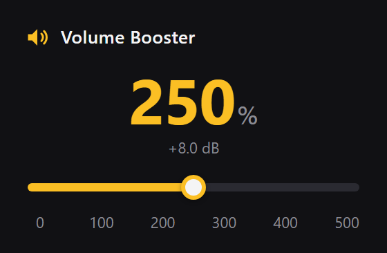

<p align="center"></p>

# Volume Booster

Boost any tab's audio up to **500%**, including DRM-protected streams.



## Features

- 0–500%, shown as a percentage and in dB, with the level on the toolbar badge.
- Works on DRM content, inside iframes and shadow roots.
- Each tab has its own volume, so boosting one never affects the others.

## Build

Requires Node 20.12+.

```sh
npm install
npm run build      # → dist
```

- Chrome: `chrome://extensions` → *Load unpacked* → `dist`
- Firefox: `about:debugging` → *Load Temporary Add-on* → `dist/manifest.json`
